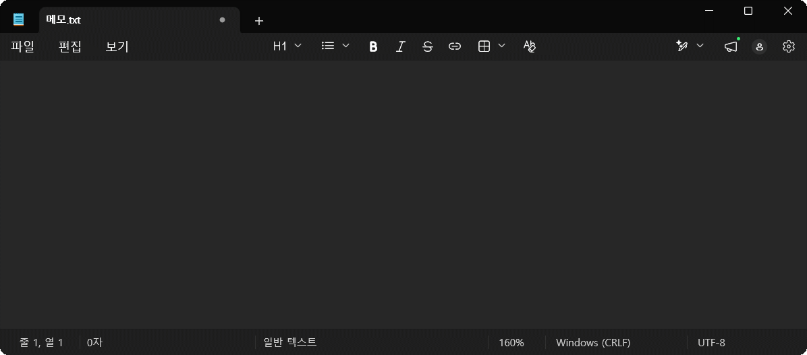

# 술술

단축키를 누르고 말하면 글로 바꿔 주는 Windows 받아쓰기 앱입니다.
음성은 내 컴퓨터에서 인식하고, 받아쓴 글은 클립보드에 복사하거나 입력 중인 곳에 바로 넣어 줍니다.

## 쓰는 법

1. 어느 프로그램에서든 단축키(**오른쪽 Ctrl**)를 누릅니다. 화면 아래에 물방울이 떠오르면 녹음 중입니다.
2. 말합니다.
3. **단축키를** 다시 누릅니다. 물방울이 터져 작은 방울들이 도는 동안 받아쓰고, 끝나면 글을 클립보드에 복사합니다.

위 화면처럼 입력 중인 곳에 바로 넣으려면 **설정 → 일반 → 받아쓰기 결과**에서 **커서 위치에 붙여넣기**를 고르세요.

## 글 다듬기

글 다듬기를 켜면 받아쓴 글을 언어 모델(LLM)이 다듬은 뒤에 넣어 줍니다.
군말을 빼고, 말하다 고친 곳은 고친 쪽만 남기고, 맞춤법과 문장 부호를 바로잡습니다.

| 받아쓴 원문 | 다듬은 글 |
|---|---|
| 음 그러니까 이번 회의는 화요일 아니 수요일 오후 세 시에 할게요 자료는 막 전날까지 보내 주세요 | 이번 회의는 수요일 오후 세 시에 할게요. 자료는 전날까지 보내 주세요. |

모델은 내 컴퓨터에서 돌리는 로컬 모델이나 OpenAI, Anthropic, Google Gemini 같은 외부 제공자 가운데 고릅니다.

## 그 밖의 기능

| 기능 | 설명 |
|---|---|
| 음성 인식 | Whisper나 SenseVoice 모델을 내려받아 씁니다. 쓸 수 있는 GPU가 없으면 CPU로 인식합니다. |
| 받아쓰기 결과 | 클립보드에 복사, 커서 위치에 붙여넣기, 자동 가운데 고릅니다. |
| 단축키 | 다른 키나 조합으로 바꿀 수 있고, 누르고 있는 동안만 녹음하게 할 수도 있습니다. |
| 기록 | 받아쓴 글이 최근 200개까지 남아 다시 복사할 수 있습니다. |
| 트레이 | 창을 닫아도 알림 영역(트레이)에서 계속 동작하고, 로그인할 때 자동으로 실행하게 할 수 있습니다. |

## 시작하기

[릴리스](https://github.com/YubinMoon/sulsul/releases)에서 Windows 설치 파일을 내려받아 설치합니다.

앱이 뜨면 **모델 관리 → 음성 인식 → 로컬 모델 내려받기**에서 모델을 내려받습니다. `추천` 표시가 붙은 모델부터 써 보세요.
다 받으면 바로 **오른쪽 Ctrl**을 누르고 말해 볼 수 있습니다.

단축키와 엔진 설정, 글 다듬기, 설정 파일, 자주 묻는 질문은 [사용 안내](docs/guide.md)에 있습니다.
소스에서 직접 빌드하려면 [개발 안내](docs/development.md)를 보세요.

## 라이선스

[MIT 라이선스](LICENSE)입니다. 함께 쓰는 글꼴과 모델의 라이선스는 [사용 안내](docs/guide.md#라이선스)에 있습니다.
